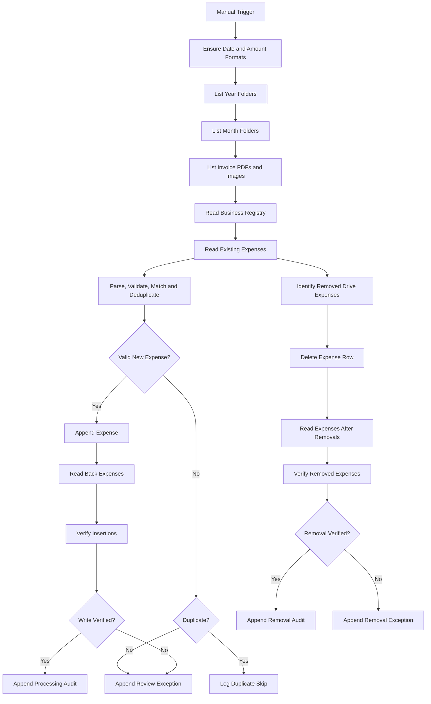

# n8n Drive Expense Sync

An n8n workflow that discovers invoice PDFs and images in nested Google Drive folders, parses bookkeeping information from structured filenames, and synchronizes expenses with Google Sheets.

The workflow prevents duplicate expenses, supports optional business-registry enrichment, verifies spreadsheet writes, maintains audit and exception logs, and removes spreadsheet expenses whose invoices are no longer represented in Google Drive.

## Features

- Dynamically scans nested Google Drive folders:

  ```text
  Receipt/
  └── <Year>/
      └── <Month>/
          └── invoice-file
  ```

- Supports PDF and image invoices.
- Extracts bookkeeping fields from structured filenames.
- Validates invoice dates, amounts, TINs, and invoice numbers.
- Preserves leading zeros in identifiers.
- Prevents duplicates using Tax Identifier Number and Invoice Number.
- Inserts expenses even when the TIN is not present in the Business Registry.
- Optionally populates Client and Category from the Business Registry.
- Leaves Description empty.
- Formats expense dates as `YYYY-MM-DD`.
- Displays amounts as Philippine peso currency, such as `₱1,227.00`.
- Keeps amounts numeric so spreadsheet totals continue working.
- Verifies inserted rows before recording a successful audit.
- Removes expenses whose TIN and Invoice Number are no longer represented in Drive.
- Records processing results in dedicated audit and exception sheets.
- Includes safeguards against accidental bulk deletion.
- Uses a manual trigger by default for controlled testing and deployment.

## Supported Files

Google Drive discovery accepts:

- PDF
- JPEG/JPG
- PNG
- GIF
- WebP
- HEIC/HEIF
- TIFF
- BMP
- Other files with a Google Drive MIME type beginning with `image/`

File contents are not scanned. All bookkeeping information must be encoded in the filename.

## Filename Convention

Invoice filenames must contain exactly five non-empty fields separated by `|`:

```text
Company|TIN|MMDDYY|InvoiceNumber|AmountCents.ext
```

Example using fictional data:

```text
Example Supplier|12345678900000|080926|000123|177822.pdf
```

This is interpreted as:

| Field | Value |
|---|---|
| Company | `Example Supplier` |
| Tax Identifier Number | `12345678900000` |
| Invoice date | `2026-08-09` |
| Invoice number | `000123` |
| Amount | `₱1,778.22` |

### Date encoding

Filename dates use six digits in `MMDDYY` format:

```text
080926
```

Spreadsheet dates are written and displayed as:

```text
2026-08-09
```

### Amount encoding

The final two digits represent decimal places:

```text
177822 → 1778.22 → ₱1,778.22
```

Amounts remain numeric in Google Sheets so totals and other arithmetic formulas continue working.

## Workflow Overview



## Google Sheets Structure

### Expenses

Headers are expected on row 3, with data beginning on row 4.

| Column | Header |
|---:|---|
| A | Date |
| B | Tax Identifier Number |
| C | Invoice Number |
| D | Client |
| E | Description |
| F | Category |
| G | Amount |

TIN and Invoice Number are written as strings to preserve leading zeros.

### Business Registry

| Column | Header |
|---:|---|
| A | Tax Identifier Number |
| B | Registered Business Name |
| C | Category |
| D | Address |

A missing, incomplete, or non-unique Business Registry match does not prevent expense insertion. When no usable match exists, Client and Category remain blank.

### Automation Audit Log

| Column | Header |
|---:|---|
| A | Processing Timestamp |
| B | Source File ID |
| C | Original Filename |
| D | TIN |
| E | Invoice Number |
| F | Invoice Date |
| G | Amount |
| H | Status |
| I | Expenses Row |
| J | Message |

### Automation Exception Queue

| Column | Header |
|---:|---|
| A | Processing Timestamp |
| B | Source File ID |
| C | Original Filename |
| D | Status |
| E | Reason |
| F | TIN |
| G | Invoice Number |
| H | Invoice Date |
| I | Amount |

## Duplicate Detection

An expense is considered a duplicate when the following pair already exists in the Expenses sheet:

```text
Tax Identifier Number + Invoice Number
```

Duplicate records are not inserted again. They are recorded as skipped processing events.

## Drive-to-Sheet Removal Synchronization

The workflow compares every populated expense against the currently discovered Drive invoices.

An expense is eligible for removal when:

1. It has a non-empty TIN.
2. It has a non-empty Invoice Number.
3. No currently discovered Drive filename contains the same TIN and Invoice Number.

Rows are deleted from bottom to top to prevent row-number shifts.

After deletion, the Expenses sheet is read again to verify that the record is gone. Successful removals are written to the audit log; failures are written to the exception queue.

### Removal safeguards

Reconciliation stops without deleting anything when:

- Drive discovery returns no PDF or image files.
- No valid TIN and Invoice Number pairs can be extracted from Drive filenames.
- The number of proposed removals exceeds the configured bulk-removal safety threshold.

The default threshold is the greater of:

```text
10 rows
```

or:

```text
25% of populated expense rows
```

Review this behavior carefully before publishing the workflow.

## Validation Rules

A filename is routed to the exception queue when:

- It does not contain exactly five non-empty fields.
- The TIN contains characters other than digits.
- The invoice date is not a valid `MMDDYY` date.
- The amount is not a valid whole-number cent value.
- The amount exceeds the supported numeric range.
- Spreadsheet insertion cannot be verified.

A missing Business Registry match is not considered an exception.

## Requirements

- A self-hosted or managed n8n instance.
- Google Drive OAuth2 credentials.
- Google Sheets OAuth2 credentials.
- A Google Drive `Receipt` folder using the expected year/month hierarchy.
- A Google Sheets workbook containing:
  - `Expenses`
  - `Business Registry`
  - `Automation Audit Log`
  - `Automation Exception Queue`

## OAuth Permissions

### Google Drive

The workflow only needs read access:

```text
https://www.googleapis.com/auth/drive.readonly
```

The workflow does not rename, move, edit, or delete Drive files.

### Google Sheets

The workflow requires spreadsheet read and write access so it can:

- Read existing expenses.
- Read the Business Registry.
- Append expenses.
- Delete stale expense rows.
- Apply date and currency formats.
- Write audit and exception records.
- Read rows back for verification.

## Installation

1. Download or clone the repository:

   ```bash
   git clone https://github.com/<your-account>/n8n-drive-expense-sync.git
   ```

2. Open your n8n instance.

3. Create a new workflow.

4. Select:

   ```text
   More actions → Import → From file
   ```

5. Import the workflow JSON.

6. Connect your own Google Drive and Google Sheets credentials manually.

7. Replace all environment-specific placeholders:
   - Receipt root-folder ID
   - Spreadsheet ID
   - Sheet names, if different
   - Credential references

8. Confirm that the Expenses table uses:

   ```text
   Header row: 3
   First data row: 4
   ```

9. Run the Drive discovery and read-only validation nodes first.

10. Test with controlled, non-production invoice files.

11. Verify:
    - Date conversion
    - Currency formatting
    - TIN and Invoice Number preservation
    - Duplicate detection
    - Business Registry lookup
    - Expense insertion
    - Insertion readback
    - Audit logging
    - Exception routing
    - Removal identification and verification

12. Publish or activate the workflow only after all checks pass.

## Recommended Deployment Process

1. Keep the workflow on a Manual Trigger.
2. Test Drive discovery without downstream writes.
3. Test parsing with synthetic filenames.
4. Test malformed and duplicate routes.
5. Test a valid insertion against a non-production record.
6. Confirm that spreadsheet formulas remain intact.
7. Review the removal-candidate count.
8. Publish only after insertion and removal verification succeeds.
9. Add a scheduled trigger only after the manual workflow is stable.

## Limitations

- The workflow does not perform OCR.
- It does not inspect PDF or image contents.
- All bookkeeping data must be encoded in the filename.
- Files with malformed filenames are not automatically repaired.
- Client and Category may remain blank when the TIN is unavailable in the Business Registry.
- Drive removal synchronization is based on TIN and Invoice Number, not only the Drive file ID.
- The workflow assumes two folder levels beneath `Receipt`: year and month.
- Existing spreadsheet values stored as text may require separate normalization before number formatting applies.

## Status

The workflow should remain inactive and unpublished until its credentials, resource identifiers, spreadsheet structure, and controlled test cases have been configured and verified.